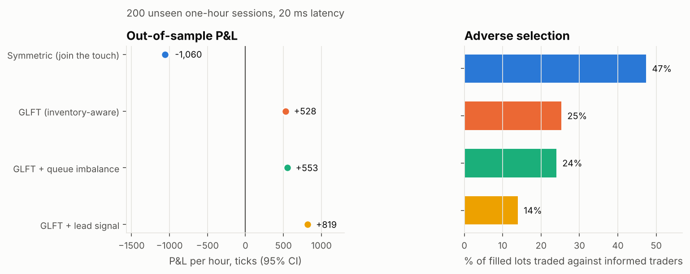
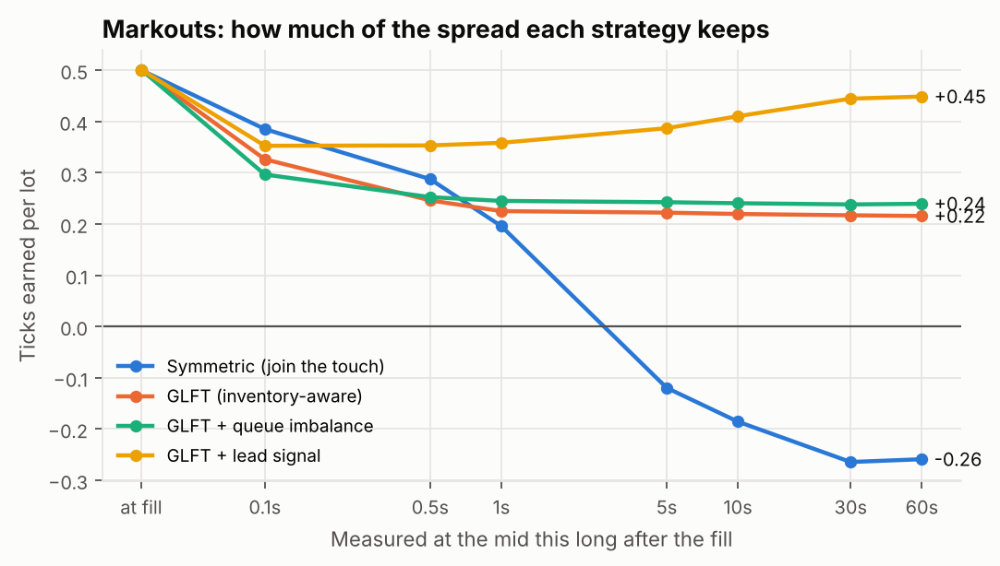
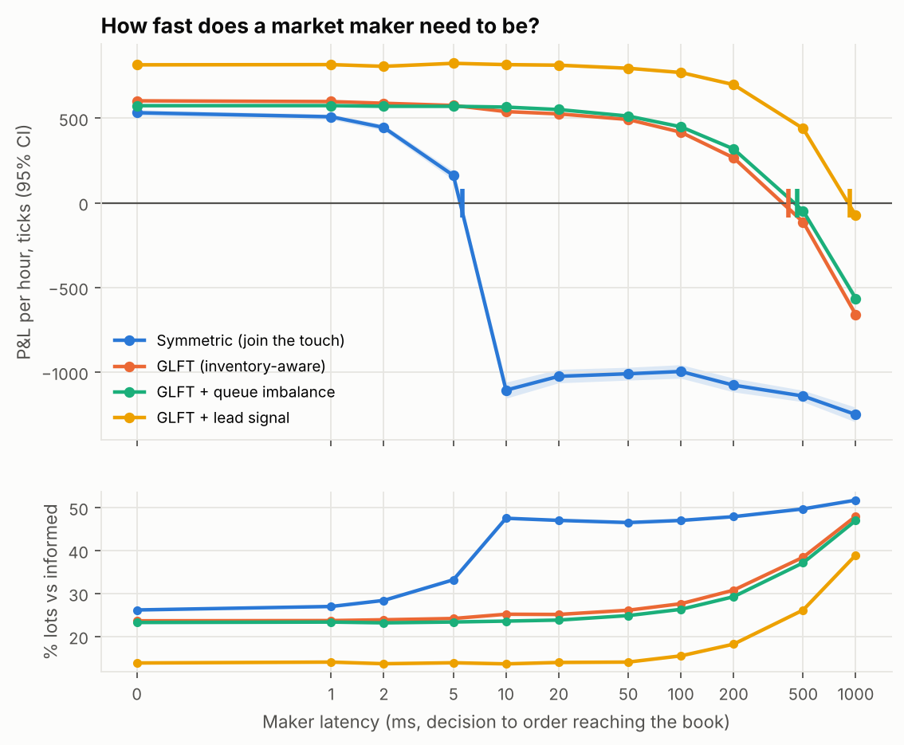
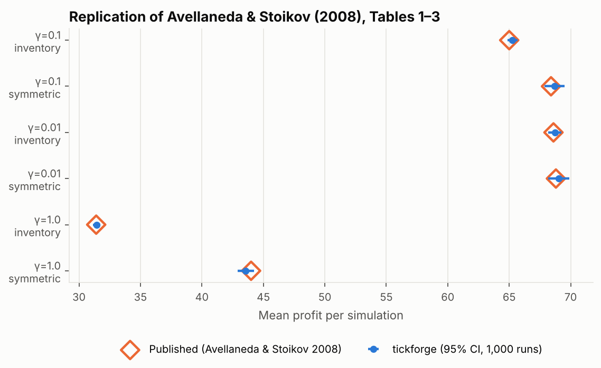
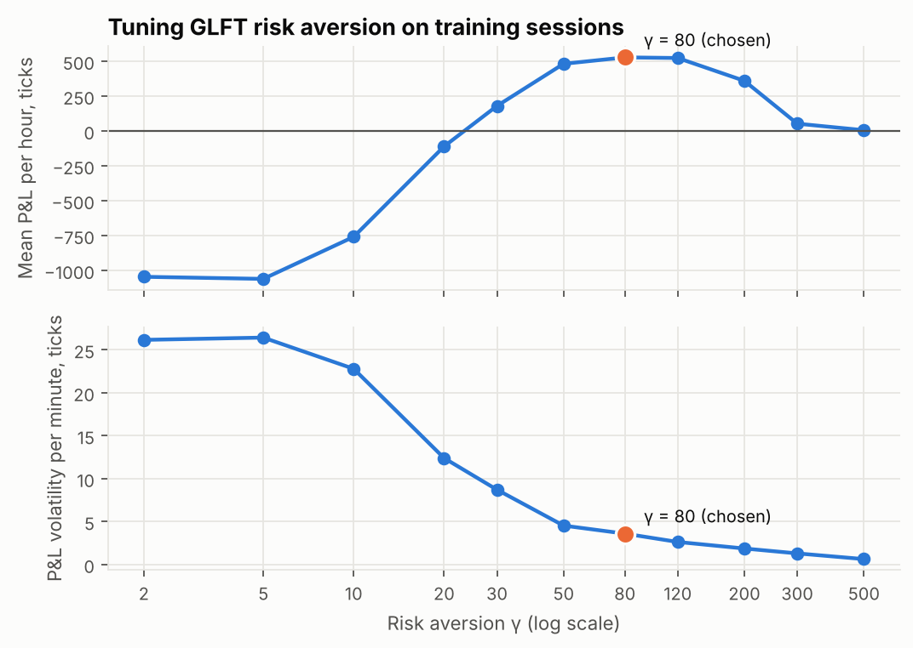

# tickforge

[](https://github.com/acftw/tickforge/actions)


**A limit order book matching engine in C++, an agent-based market built on it, and an
honest test of market-making strategies.**

**Website, with an interactive 3D model of the order book:** [acftw.github.io/tickforge](https://acftw.github.io/tickforge/)

* **Matching engine:** price-time priority, about **20 million messages a second**
  (50 ns each), **6.5x faster** than a textbook `std::map` book. It's checked against
  two independent reference books on 800,000 random orders.
* **Replication:** reruns Avellaneda & Stoikov (2008). All six published results are
  reproduced within **1.3 standard errors**.
* **Study:** four market-making strategies, calibrated from the public tape, tuned on
  training sessions and tested on **200 unseen one-hour sessions**. Informed traders
  are in the market, and latency is swept from 0 to 1 second.

```text
$ tickforge study

  200 unseen sessions, 20 ms latency           P&L/hour (95% CI)   lots vs informed traders
  Symmetric (join the touch)                   -1,060 [-1,088, -1,033]      47%
  GLFT (inventory-aware, gamma=80)               +528 [  +522,   +533]      25%
  GLFT + queue imbalance                         +553 [  +550,   +557]      24%
  GLFT + lead signal                             +819 [  +814,   +825]      14%

  queue haircut: the textbook fill model predicts 7.5x more fills than the maker gets
  latency at which P&L reaches zero: symmetric 6 ms, GLFT 411 ms, GLFT + lead 928 ms
```

---

## Findings

**1. The textbook fill model overstates fills 7.5x.**
Avellaneda–Stoikov and GLFT assume a quote at distance δ from the mid fills at rate
A·e^(−κδ). Calibrating A and κ from the trade tape assumes you're filled whenever a
trade reaches your price. In a queue you're filled only after everyone ahead of you.
Over 200 sessions the calibrated model predicts 2.32 million fills for the maker's
quotes, but it receives 310,000 (13%). The fills that do reach the back of the queue
are disproportionately informed sweeps.

**2. Inventory control turns a losing maker into a consistent winner.**
At 20 ms latency, joining the touch on both sides lost money in **all 200** test
sessions (−1,060 ticks/hour). 47% of its lots traded against informed traders, and
its inventory swung ±14 lots. GLFT with tuned risk aversion made +528/hour with **no**
losing session. Per-minute P&L volatility fell **7x** (26.6 → 3.8 ticks). The paired
difference is +1,588 ticks/hour (95% CI 1,560 to 1,616). Here risk control pays for
itself in mean P&L, not just in Sharpe, because inventory built against informed flow
loses money.



**3. A leading signal is worth +55%, and it works by avoiding adverse selection.**
The lead-signal maker quotes around the fundamental as seen in a leading market, like
NIFTY futures moving before a stock. That earned **+291 ticks/hour more than GLFT**
(95% CI 283 to 299, better in all 200 paired sessions). It traded only 14% of its lots
against informed traders. Markouts show the mechanism. Every strategy captures half a tick at the moment of
the fill. A minute later, GLFT keeps 0.22 of it and the symmetric maker is at −0.26,
because prices moved against its fills. The lead-signal maker keeps 0.45.



**4. Queue imbalance helps only a little here.** It adds +25 ticks/hour (95% CI 19
to 32), better in 72% of sessions. Imbalance is a well-documented predictor in real
markets, but in this market prices move on hidden jumps the book can't foresee. This
is an honest null-ish result.

**5. Latency is the strategy.**
Each strategy has a latency at which it stops making money:

| Strategy | Profitable up to |
|---|---|
| Symmetric | ~6 ms |
| GLFT | ~411 ms |
| GLFT + queue imbalance | ~461 ms |
| GLFT + lead signal | ~928 ms |

The mechanism is visible in the data. With delay, the maker acts on a book that has
already changed: it re-posts stale prices and churns orders. The symmetric maker
sends 1,667 orders/hour at 0 ms and 3,940 at 200 ms, losing queue priority each time.
Its share of fills against informed traders rises from 26% to 48%. This is the
"HFT arms race" (Budish, Cramton & Shim 2015) in one chart.



---

## How it works

### The matching engine ([`order_book.hpp`](include/tickforge/order_book.hpp))

* **Prices are array indices** (integer ticks in a fixed band), so a price level is an
  O(1) lookup, not a tree search.
* **Orders live in a preallocated pool**, linked into their level's FIFO queue by
  index (an intrusive doubly linked list). Add, cancel and fill are O(1), with no
  allocation once warm.
* **Ids encode pool slot + generation**, so lookups need no hash map, and a stale id
  can never cancel the new order that reused its slot.
* **A two-level bitmap** ([`level_bitmap.hpp`](include/tickforge/level_bitmap.hpp))
  finds the next non-empty level 64 levels per instruction when the best level empties.
* It supports GTC/IOC limit orders, market orders, cancel, and size reduction that
  keeps queue priority.

**Correctness.** [`reference_book.hpp`](include/tickforge/reference_book.hpp) is a
deliberately simple `std::map` + `std::deque` book that shares no code with the fast
one. The differential test feeds both 800,000 random orders, cancels and reductions.
It checks every fill (about 171,000) and the full book state after every operation. A
separate pure-Python book cross-checks it again from the Python tests. C++ tests run
under AddressSanitizer and UndefinedBehaviorSanitizer in CI, with GCC and Clang on Linux
and Apple Clang on macOS.

**Speed.** On a 2-vCPU cloud Xeon at 2.3 GHz, replaying 5 million messages (55% add,
38% cancel, 7% market):

| Book | Messages/s | ns/message | p50 | p99 | p99.9 |
|---|---|---|---|---|---|
| tickforge | 20.0 M | 50 | 99 ns | 582 ns | 881 ns |
| `std::map` reference | 3.1 M | 327 | 195 ns | 3,432 ns | 7,825 ns |

Latency percentiles include about 20 ns of clock overhead. Numbers vary by machine;
rerun with `./build/bench_order_book`.

### Replicating Avellaneda & Stoikov (2008) ([`as_model.py`](python/tickforge/as_model.py))

The paper's exact experiment: s = 100, T = 1, σ = 2, dt = 0.005, k = 1.5, A = 140,
1,000 simulations. Both strategies see the same price paths (common random numbers).

| γ | Strategy | Profit | Paper | z | Std(profit) | Paper |
|---|---|---|---|---|---|---|
| 0.1 | inventory | 65.26 | 65.0 | +1.24 | 6.51 | 6.6 |
| 0.1 | symmetric | 68.68 | 68.4 | +0.68 | 12.93 | 12.7 |
| 0.01 | inventory | 68.71 | 68.6 | +0.41 | 8.65 | 8.7 |
| 0.01 | symmetric | 69.03 | 68.8 | +0.53 | 13.48 | 12.8 |
| 1 | inventory | 31.44 | 31.4 | +0.25 | 4.92 | 5.0 |
| 1 | symmetric | 43.57 | 44.0 | −1.26 | 10.86 | 11.0 |



### The simulated market ([`market_sim.cpp`](src/market_sim.cpp))

All traders submit orders to the same matching engine:

* A hidden **fundamental value** jumps ±1 tick at random (0.1 jumps/second).
* **Liquidity providers** post limit orders near the touch and cancel them at random.
* **Noise traders** send random market orders.
* **Informed traders** know the fundamental and sweep any order mispriced against it.
  They react in 200 ms on average.
* **The market maker** under test re-quotes every 10 ms. Its orders reach the book
  after a set latency, at the back of the queue. It may also watch a lead signal.

Background events are exact Poisson processes (Gillespie's method), interleaved with
the maker's scheduled timer and delayed orders. The market is tuned so informed traders
take about 80% of what noise traders lose. That leaves the background liquidity
providers a thin margin, close to the competitive Glosten–Milgrom benchmark where
they would earn nothing. A one-hour session runs in
about 0.06 s, and the whole study simulates about 5,900 hours in 2 minutes.

**Strategies:**
* **Symmetric** quotes the touch on both sides, with an inventory limit only.
* **GLFT** uses the closed-form quotes of Guéant, Lehalle & Fernandez-Tapia (2013),
  which skew both quotes against inventory.
* **GLFT + queue imbalance** shifts fair value toward the heavier side of the touch.
* **GLFT + lead signal** uses the leading market's price as fair value.

### The study protocol ([`study.py`](python/tickforge/study.py))

1. **Calibrate** from market-maker-free sessions, using only the public tape:
   σ = 0.234 ticks/√s, A = 23.9 fills/s, κ = 5.14 per tick.
2. **Tune** on 40 training sessions. GLFT's γ is chosen by the highest mean P&L
   (γ = 80), then the imbalance weight.
3. **Test** on 200 unseen sessions: bootstrap 95% confidence intervals, and paired
   comparisons on identical seeds.
4. **Sweep latency** from 0 to 1,000 ms on 100 further unseen sessions.

A note on step 2: an earlier draft chose γ by Sharpe ratio. That kept pushing γ to the
edge of the grid, giving up a third of the P&L to reduce variance in sessions that
never lost money. I switched to mean P&L, which a desk with fixed risk limits would
maximise. The chart below shows the whole trade-off, so you can judge it yourself.



---

## Limitations

* **The market is stylized:** one-tick spreads, ±1-tick jumps, one fast market maker
  against slow background liquidity, and no fees, rebates or competing HFTs. The
  absolute P&L and the very high hourly Sharpe ratios are therefore not realistic.
  The comparisons and mechanisms are the result.
* **Time is stylized too.** What matters is the maker's latency relative to the
  informed traders' 200 ms reaction time, not the absolute milliseconds.
* **The lead signal is perfect.** It equals the fundamental without noise. A real
  lead-lag signal is noisy and partially priced in already, so +55% is an upper bound.
* **One market configuration.** The results depend on the mix of noise and informed
  flow. The simulator makes that easy to vary, and that's the natural next step.

---

## Quick start

```bash
git clone https://github.com/acftw/tickforge && cd tickforge
pip install ".[dev]"          # builds the C++ extension (needs a C++20 compiler)

tickforge replicate-as        # Avellaneda & Stoikov tables, ~1 s
tickforge study               # full study, ~2 min on 2 cores -> results/study.json
tickforge figures             # redraw docs/img/*.png
tickforge all --quick         # everything, small and fast
tickforge site                # rebuild the website's data (docs/data)
pytest                        # Python tests

# C++ tests (with sanitizers) and benchmark
cmake -S . -B build -DTICKFORGE_BUILD_TESTS=ON -DTICKFORGE_BUILD_BENCH=ON -DCMAKE_BUILD_TYPE=Release
cmake --build build -j && ./build/tickforge_tests && ./build/bench_order_book
```

Step-by-step instructions for a Mac, with what each command should print, are in
[VERIFY.md](VERIFY.md).

From Python:

```python
import tickforge as tf

book = tf.OrderBook(1, 10_000)
book.add_limit(tf.Side.SELL, 101, 5)
book.add_limit(tf.Side.BUY, 101, 3)
print([(f.price, f.qty) for f in book.fills()])     # [(101, 3)]

maker = tf.MakerConfig()
maker.strategy, maker.gamma, maker.lead_coef, maker.latency = tf.Strategy.GLFT, 80.0, 1.0, 0.02
maker.sigma, maker.A, maker.kappa = 0.234, 23.9, 5.14
r = tf.simulate(tf.MarketConfig(), maker, seed=1)   # one simulated hour
print(r["final_cash"] + r["final_inventory"] * r["final_mid"])
```

## Repository layout

```text
include/tickforge/   order_book.hpp, level_bitmap.hpp, reference_book.hpp, market_sim.hpp
src/                 market_sim.cpp (simulator + quoting rule), bindings.cpp (pybind11)
bench/               order book benchmark
tests/cpp/           doctest: unit, differential and simulator tests
tests/python/        pytest: cross-check vs pure-Python book, replication, calibration, metrics
python/tickforge/    as_model, calibration, analysis, study, report, cli
results/             JSON behind every number in this README
docs/                website (index.html + data/) and README charts (img/)
GUIDE.md             plain-language walkthrough of every part, with interview questions
VERIFY.md            how to install and check everything on your own Mac
```

## References

* Avellaneda, M. & Stoikov, S. (2008). High-frequency trading in a limit order book.
  *Quantitative Finance* 8(3).
* Guéant, O., Lehalle, C.-A. & Fernandez-Tapia, J. (2013). Dealing with the inventory
  risk: a solution to the market making problem. *Mathematics and Financial Economics* 7.
* Glosten, L. & Milgrom, P. (1985). Bid, ask and transaction prices in a specialist
  market with heterogeneously informed traders. *Journal of Financial Economics* 14.
* Budish, E., Cramton, P. & Shim, J. (2015). The high-frequency trading arms race.
  *Quarterly Journal of Economics* 130(4).
* Cartea, Á., Donnelly, R. & Jaimungal, S. (2018). Enhancing trading strategies with
  order book signals. *Applied Mathematical Finance* 25(1).

MIT License · Agastya Chavan
